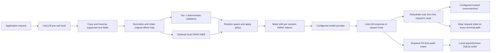

# SovereignGate Guardrail — V1 Architecture

**Status:** Proposed architecture; implementation has not started. This document defines the V1 boundaries and design; the implementation plan is in [`TASKS.md`](./TASKS.md).

SovereignGate provides **configurable data-minimization and technical safeguard controls (supporting GDPR Art. 5(1)(c) & Art. 32)**. It does not determine or certify legal compliance.

## 1. Product boundary

SovereignGate is an in-process LiteLLM custom guardrail, not a standalone proxy. It transforms supported text fields before LiteLLM sends a request to its configured model provider, and can restore values at configured trusted response or tool-execution boundaries. It does not stop LiteLLM or the configured provider from making their ordinary network requests. The `engine/` and `evidence/` hot paths themselves are local and offline.

V1 detects only configured, supported entity categories. Undetected text is not automatically made safe. Image OCR, binary payload inspection, and a hosted control plane are outside the V1 boundary.

## 2. Runtime flow

The audit enqueue and vault cleanup are lifecycle concerns: every success, exception, cancellation, and completed/aborted stream must release the request's vault. Audit persistence is handled by a background writer, not synchronous disk writes in the request hook.

## 3. Modules and dependency direction

Canonical Python source layout is `src/sovereigngate/`.

| Component | Responsibility | Must not depend on |
| --- | --- | --- |
| `config.py` | Strict Pydantic policy/config parsing, environment settings, validation | Engine, adapter, or evidence modules |
| `engine/normalizer.py` | Unicode normalization, obfuscation handling, entropy/encoding signals, offset mapping | LiteLLM, network services, evidence storage |
| `engine/detectors.py` | Tier 1 candidates and check-digit validation using local validators | Adapter, network services |
| `engine/ner_onnx.py` | Optional CPU NER over a locally provisioned model artifact | Model downloads, telemetry, adapter |
| `engine/pipeline.py` | Orchestrate normalization, detection, overlap resolution, and policy decisions | LiteLLM request objects, disk I/O |
| `engine/vault.py` | HMAC token derivation, request-scoped lookup, stream token buffering | Persistent storage, network services |
| `adapters/litellm_guardrail.py` | Translate LiteLLM payloads to/from engine results; manage request lifecycle | Direct detector implementations |
| `evidence/audit_log.py` | Validate and enqueue sanitized audit records; background SQLite writer and verifier | Raw message/prompt data, network services |
| `evidence/exporter.py`, `cli.py` | Offline verification, dry-run, and evidence report generation | Prompt content in exported records |

The dependency direction is `adapter -> config + engine + evidence interface`; `engine -> config/domain types`; `evidence` owns its record schema and persistence. The core engine and evidence writer must remain independently testable without importing LiteLLM.

## 4. Processing and policy decisions

1. **Load policy before traffic.** Validate YAML and environment values with strict Pydantic v2 models. `shadow` is the initial mode; `enforce` applies configured `mask`, `block`, `shadow_log`, or `allow` actions. An invalid policy is a startup/configuration error, not a permissive default.
2. **Copy and traverse payloads.** Never mutate caller-owned dictionaries in place. Inspect string content, supported text blocks, tool-call argument JSON, and tool outputs. Parse and re-serialize JSON arguments without changing non-string values. Binary/image contents are not inspected.
3. **Normalize with reversible offsets.** Apply NFKC and remove specified zero-width characters; collapse configured separator obfuscation while mapping normalized spans back to the original input. Enforce a bounded decode/scan policy for suspicious encoded or high-entropy data; do not recursively scan without a resource limit.
4. **Detect locally.** Run Tier 1 structural candidates through country-specific/check-digit validators. Tier 2 NER is opt-in, CPU-based, and uses a locally provisioned, versioned artifact. The default path has no external model fetch or other network access.
5. **Resolve and act.** Return immutable spans mapped to original text. Deterministic Tier 1 spans win overlaps with Tier 2; adjacent/nested matches are resolved before replacement. The pipeline applies the selected entity policy and produces sanitized metadata for LiteLLM routing.
6. **Pseudonymize.** Derive a deterministic session token from the configured HMAC secret, session ID, entity type, and canonical value. Store originals only in a request-scoped in-memory vault for permitted restoration. If there is no conversation session ID, use a per-request UUID; tokens then do not persist across separate requests.
7. **Handle responses and streams.** Keep request context available from pre-call through post-call/stream completion. Buffer a possible partial placeholder prefix up to the maximum 32-character token length. Restore only tokens present in that request's vault; an unknown syntactically valid token is left unchanged. Rehydration should occur only at a boundary trusted to receive the original value.
8. **Audit and release.** Produce counts, category/action labels, routing metadata, and timing only. Enqueue the record without waiting for disk I/O. Wipe the vault in `finally`-style cleanup, including stream exhaustion, errors, and cancellation.

In `enforce` mode, unexpected parsing, normalization, or detector failures follow `on_error`; `fail_closed` must prevent an unmasked outbound request. Error messages and logs identify only safe categories/rule IDs, never payloads, matched values, tool arguments, or vault contents. `shadow` observes and records but must neither alter payloads nor block on policy findings.

## 5. Audit and evidence model

SQLite in WAL mode is the canonical local audit store. A background writer assigns sequence numbers and links canonical serialized records with SHA-256. JSONL, if implemented, is an offline export/backup and not a separate source of truth. Records contain only approved metadata (for example request ID, mode, policy digest, model target, entity counts, action, timing, previous hash, and record hash). Actor identifiers must be opaque/pseudonymized before enqueueing.

Hash chaining makes edits and interior deletions detectable when verifying a retained chain. It does not by itself prevent deletion of the entire database or prove that the latest tail was not removed; stronger external anchoring is outside V1. The report/export is evidence of configured technical controls, not a compliance certificate or a complete DPIA.

Queue saturation and writer failure need an explicit operational policy before implementation: request hooks must not wait for disk, and evidence loss must not be silent. The policy should distinguish shadow-mode availability from enforce-mode fail-closed requirements and expose sanitized health/overflow metrics.

## 6. Security and privacy boundaries

- **Raw data:** Raw prompt and response strings exist transiently in process memory. Only configured detected spans are replaced; missed or unsupported PII can still reach the provider.
- **Vault:** It is request-scoped, never persisted or logged, and must redact `repr`/`str`. Python cannot guarantee physical zeroization of immutable string allocations; overwrite/release is best-effort memory hygiene, not a cryptographic erasure guarantee.
- **Tokens:** Tokens are pseudonyms, not anonymization. The secret is required for stable cross-request tokens and must be managed as a production secret. Ephemeral development secrets produce unstable tokens after restart.
- **Provider and tools:** A configured provider receives the masked prompt, subject to detection coverage. A downstream tool may receive restored values only if configured to do so. The application is responsible for controlling who receives rehydrated output.
- **Audit:** Never persist raw messages, matched values, vault mappings, raw exceptions, or untrusted free-form strings. Keep local database access restricted and backups protected.
- **Regulatory framing:** SovereignGate supplies configurable technical controls; operators remain responsible for lawful basis, retention, access control, DPIA decisions, provider selection, and user-facing AI disclosure.

## 7. Open risks / decisions to resolve before external pilot

1. **Six-hex token suffix:** The required 6-hex suffix provides only 24 bits and cannot guarantee uniqueness for arbitrary values in one session. Define and test collision detection/handling; obtain explicit risk acceptance or revise the token format before pilot. Never silently overwrite a vault mapping.
2. **EU-27 coverage evidence:** Maintain a country/identifier matrix tied to actual `python-stdnum` support and verified valid/invalid fixtures. Do not imply every national identifier is implemented merely because EU-27 is the target.
3. **NER model supply chain:** Select a model/license, pin the artifact digest and tokenizer/config, and document local provisioning. Model download at runtime is prohibited.
4. **Audit queue failure:** Specify queue capacity, overflow behavior per mode, operator alerting, flush timeout, and shutdown behavior before implementation.
5. **Restoration boundary:** Confirm which LiteLLM response and tool-call paths are trusted to receive original values, including streaming, retries, errors, and cancellation. Rehydrating an assistant response may intentionally expose the original values to the application caller.
6. **Benchmark reproducibility:** Fix the synthetic dataset seed, ground-truth rules, environment, and Presidio version. Report absolute release thresholds and baseline comparisons separately.