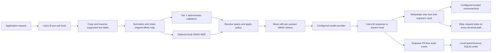

# SovereignGate Guardrail — V1 Architecture

**Status:** Proposed architecture; implementation has not started. This document defines the V1 boundaries and design; the implementation plan is in [`TASKS.md`](./TASKS.md).

SovereignGate provides **configurable data-minimization and technical safeguard controls (supporting GDPR Art. 5(1)(c) & Art. 32)**. It does not determine or certify legal compliance.

## 1. Product boundary

SovereignGate is an in-process LiteLLM custom guardrail, not a standalone proxy. It transforms supported text fields before LiteLLM sends a request to its configured model provider, and can restore values at configured trusted response or tool-execution boundaries. It does not stop LiteLLM or the configured provider from making their ordinary network requests. The `engine/` and `evidence/` hot paths themselves are local and offline.

V1 detects only configured, supported entity categories. Undetected text is not automatically made safe. Image OCR, binary payload inspection, and a hosted control plane are outside the V1 boundary.

## 2. Runtime flow

The audit enqueue and vault cleanup are lifecycle concerns: every success, exception, cancellation, and completed/aborted stream must release the request's vault. Audit persistence is handled by a background writer, not synchronous disk writes in the request hook.

## 3. Modules and dependency direction

Canonical Python source layout is `src/sovereigngate/`.

| Component | Responsibility | Must not depend on |
| --- | --- | --- |
| `config.py` | Strict Pydantic policy/config parsing, environment settings, validation | Engine, adapter, or evidence modules |
| `engine/normalizer.py` | Unicode normalization, obfuscation handling, entropy/encoding signals, offset mapping | LiteLLM, network services, evidence storage |
| `engine/detectors.py` | Tier 1 candidates and check-digit validation using local validators | Adapter, network services |
| `engine/ner_onnx.py` | Optional CPU NER over a locally provisioned model artifact | Model downloads, telemetry, adapter |
| `engine/pipeline.py` | Orchestrate normalization, detection, overlap resolution, and policy decisions | LiteLLM request objects, disk I/O |
| `engine/vault.py` | HMAC token derivation, request-scoped lookup, stream token buffering | Persistent storage, network services |
| `adapters/litellm_guardrail.py` | Translate LiteLLM payloads to/from engine results; manage request lifecycle | Direct detector implementations |
| `evidence/audit_log.py` | Validate and enqueue sanitized audit records; background SQLite writer and verifier | Raw message/prompt data, network services |
| `evidence/exporter.py`, `cli.py` | Offline verification, dry-run, and evidence report generation | Prompt content in exported records |

The dependency direction is `adapter -> config + engine + evidence interface`; `engine -> config/domain types`; `evidence` owns its record schema and persistence. The core engine and evidence writer must remain independently testable without importing LiteLLM.

## 4. Processing and policy decisions

1. **Load policy before traffic.** Validate YAML and environment values with strict Pydantic v2 models. `shadow` is the initial mode; `enforce` applies configured `mask`, `block`, `shadow_log`, or `allow` actions. An invalid policy is a startup/configuration error, not a permissive default.
2. **Copy and traverse payloads.** Never mutate caller-owned dictionaries in place. Inspect string content, supported text blocks, tool-call argument JSON, and tool outputs. Parse and re-serialize JSON arguments without changing non-string values. Binary/image contents are not inspected.
3. **Normalize with reversible offsets.** Apply NFKC and remove specified zero-width characters; collapse configured separator obfuscation while mapping normalized spans back to the original input. Enforce a bounded decode/scan policy for suspicious encoded or high-entropy data; do not recursively scan without a resource limit.
4. **Detect locally.** Run Tier 1 structural candidates through country-specific/check-digit validators. Tier 2 NER is opt-in, CPU-based, and uses a locally provisioned, versioned artifact. The default path has no external model fetch or other network access.
5. **Resolve and act.** Return immutable spans mapped to original text. Deterministic Tier 1 spans win overlaps with Tier 2; adjacent/nested matches are resolved before replacement. The pipeline applies the selected entity policy and produces sanitized metadata for LiteLLM routing.
6. **Pseudonymize.** Derive a deterministic session token from the configured HMAC secret, session ID, entity type, and canonical value. Store originals only in a request-scoped in-memory vault for permitted restoration. If there is no conversation session ID, use a per-request UUID; tokens then do not persist across separate requests.
7. **Handle responses and streams.** Keep request context available from pre-call through post-call/stream completion. Buffer a possible partial placeholder prefix up to the maximum 32-character token length. Restore only tokens present in that request's vault; an unknown syntactically valid token is left unchanged. Rehydration should occur only at a boundary trusted to receive the original value.
8. **Audit and release.** Produce counts, category/action labels, routing metadata, and timing only. Enqueue the record without waiting for disk I/O. Wipe the vault in `finally`-style cleanup, including stream exhaustion, errors, and cancellation.

In `enforce` mode, unexpected parsing, normalization, or detector failures follow `on_error`; `fail_closed` must prevent an unmasked outbound request. Error messages and logs identify only safe categories/rule IDs, never payloads, matched values, tool arguments, or vault contents. `shadow` observes and records but must neither alter payloads nor block on policy findings.

## 5. Audit and evidence model

SQLite in WAL mode is the canonical local audit store. A background writer assigns sequence numbers and links canonical serialized records with SHA-256. JSONL, if implemented, is an offline export/backup and not a separate source of truth. Records contain only approved metadata (for example request ID, mode, policy digest, model target, entity counts, action, timing, previous hash, and record hash). Actor identifiers must be opaque/pseudonymized before enqueueing.

Hash chaining makes edits and interior deletions detectable when verifying a retained chain. It does not by itself prevent deletion of the entire database or prove that the latest tail was not removed; stronger external anchoring is outside V1. The report/export is evidence of configured technical controls, not a compliance certificate or a complete DPIA.

The writer consumes a bounded in-memory queue of at most 10,000 sanitized records. The request hook uses non-blocking admission and creates the audit event from pre-call detection/action metadata before provider dispatch; it never waits for SQLite. If the queue is full or the writer is already unhealthy, `shadow` records a sanitized dropped-event counter and proceeds unchanged. In `enforce`, the behavior follows `on_error`: `fail_closed` blocks before provider dispatch, while explicitly configured `fail_open` proceeds with a degraded-health signal and incremented drop counter. No overflow or writer failure may be silent.

If the writer fails after a request has been dispatched, the call cannot be rolled back; mark the writer unhealthy, count affected queued records as lost, expose sanitized health state, and apply the above policy to subsequent calls. Shutdown stops new admissions and waits up to 10 seconds for the queue to drain. A timeout or writer failure must surface as a sanitized flush error and non-zero process shutdown status. Queue payloads contain only validated bounded audit fields, never prompt or response text.

## 6. Security and privacy boundaries

- **Raw data:** Raw prompt and response strings exist transiently in process memory. Only configured detected spans are replaced; missed or unsupported PII can still reach the provider.
- **Vault:** It is request-scoped, never persisted or logged, and must redact `repr`/`str`. Python cannot guarantee physical zeroization of immutable string allocations; overwrite/release is best-effort memory hygiene, not a cryptographic erasure guarantee.
- **Tokens:** Tokens are pseudonyms, not anonymization. The secret is required for stable cross-request tokens and must be managed as a production secret. Ephemeral development secrets produce unstable tokens after restart.
- **Provider and tools:** A configured provider receives the masked prompt, subject to detection coverage. A downstream tool may receive restored values only if configured to do so. The application is responsible for controlling who receives rehydrated output.
- **Audit:** Never persist raw messages, matched values, vault mappings, raw exceptions, or untrusted free-form strings. Keep local database access restricted and backups protected.
- **Regulatory framing:** SovereignGate supplies configurable technical controls; operators remain responsible for lawful basis, retention, access control, DPIA decisions, provider selection, and user-facing AI disclosure.

## 7. Phase 0 decisions and remaining pilot gates

### T01 — Token collision and request lifecycle (resolved)

- Preserve the required `[ENTITY_6HEX]` format. The suffix contains only 24 bits, so it is not collision-free; do not imply otherwise or silently generate alternate suffixes, which would break deterministic token compatibility.
- On vault insertion, compare the canonical value for an existing token. If it differs, raise a sanitized collision error containing only the entity type; in `enforce`, fail closed before provider dispatch. Never overwrite the first mapping. `shadow` mode does not create or use rehydration tokens.
- One vault is owned by a logical LiteLLM request context, shared across its internal retries and response/stream hooks, and wiped on success, error, cancellation, or stream termination. A separate request gets a separate vault. Restore only values found in that request's vault and only at the configured trusted boundary.
- Rehydrate tool-call arguments only immediately before dispatch to an explicitly allowlisted internal tool. Rehydrate assistant response text only on a route explicitly marked trusted; if trust is absent, preserve the placeholder. Apply the same rule to streaming, buffering partial tokens up to 32 characters. Tool results sent back to a model pass through pre-call masking again.
- Wiping the request vault prevents a cross-request collision registry. A different value in a later request can therefore produce a token already present in prior conversation history. This residual risk is not solved by T01; written risk-owner acceptance is mandatory before an external pilot. Without acceptance, the pilot is blocked.

### T02 — Audit queue and writer failure policy (resolved)

- Use a bounded in-memory queue with a 10,000-record capacity. Build each sanitized request-decision event before provider dispatch and admit it with non-blocking `put_nowait`; request hooks never wait for disk.
- On queue saturation or a known unhealthy writer, `shadow` mode increments a dropped-record counter, marks local health degraded, and proceeds without changing or blocking the request. In `enforce`, `on_error: fail_closed` rejects before provider dispatch; an explicit `fail_open` permits forwarding but raises the sanitized health signal and counter. No raw payload data is used in these signals.
- If a writer fails after dispatch, do not pretend that the request was rolled back: count queued records that cannot be persisted, expose the unhealthy state, and apply the same policy to subsequent requests. Shutdown drains for at most 10 seconds; timeout/failure surfaces as a sanitized flush error and non-zero process exit.

### T03 — Identifier matrix and local NER artifact (resolved)

The V1 validator baseline is `python-stdnum==2.2`. These are validator candidates, not a claim that detector implementations or fixture suites already exist. A country becomes supported only after positive and invalid-checksum tests pass. Use country-specific structural boundaries before invoking the listed validator.

| EU member state | V1 personal identifier(s) | `python-stdnum` module(s) | Coverage decision |
| --- | --- | --- | --- |
| Austria (AT) | VNR/SVNR | `stdnum.at.vnr` | Candidate |
| Belgium (BE) | National number / SSN (NISS) | `stdnum.be.ssn` | Candidate |
| Bulgaria (BG) | EGN, PNF | `stdnum.bg.egn`, `stdnum.bg.pnf` | Candidate |
| Croatia (HR) | OIB | `stdnum.hr.oib` | Candidate |
| Cyprus (CY) | — | No personal-ID validator in 2.2 | Unsupported in V1 baseline |
| Czechia (CZ) | Birth number (RC) | `stdnum.cz.rc` | Candidate |
| Denmark (DK) | CPR | `stdnum.dk.cpr` | Candidate |
| Estonia (EE) | Personal ID code (IK) | `stdnum.ee.ik` | Candidate |
| Finland (FI) | HETU | `stdnum.fi.hetu` | Candidate |
| France (FR) | NIR | `stdnum.fr.nir` | Candidate |
| Germany (DE) | Steuer-ID | `stdnum.de.idnr` | Candidate; DE social-insurance number has no module in this baseline |
| Greece (GR) | AMKA | `stdnum.gr.amka` | Candidate |
| Hungary (HU) | Personal tax identifier (ANUM) | `stdnum.hu.anum` | Candidate |
| Ireland (IE) | PPSN | `stdnum.ie.pps` | Candidate |
| Italy (IT) | Codice fiscale | `stdnum.it.codicefiscale` | Candidate |
| Latvia (LV) | — | No personal-ID validator in 2.2 | Unsupported in V1 baseline |
| Lithuania (LT) | Asmens kodas | `stdnum.lt.asmens` | Candidate |
| Luxembourg (LU) | — | No personal-ID validator in 2.2 | Unsupported in V1 baseline |
| Malta (MT) | — | No personal-ID validator in 2.2 | Unsupported in V1 baseline |
| Netherlands (NL) | BSN | `stdnum.nl.bsn` | Candidate |
| Poland (PL) | PESEL, NIP | `stdnum.pl.pesel`, `stdnum.pl.nip` | Candidate |
| Portugal (PT) | Citizen card, NIF | `stdnum.pt.cc`, `stdnum.pt.nif` | Candidate |
| Romania (RO) | CNP | `stdnum.ro.cnp` | Candidate |
| Slovakia (SK) | Birth number (RC) | `stdnum.sk.rc` | Candidate |
| Slovenia (SI) | EMŠO | `stdnum.si.emso` | Candidate |
| Spain (ES) | DNI, NIE, NIF | `stdnum.es.dni`, `stdnum.es.nie`, `stdnum.es.nif` | Candidate |
| Sweden (SE) | Personnummer | `stdnum.se.personnummer` | Candidate |

EU IBAN uses `stdnum.iban`; card candidates use Luhn validation; BIC uses `stdnum.bic`. These are separate from national-ID coverage. Unsupported-country values must not be described as validated national identifiers. The V1 coverage claim is limited to identifiers with passing fixtures, not blanket EU-27 national-ID coverage.

For every identifier, normalize with the shared NFKC/zero-width pass, then use only the candidate-specific formatting accepted by that identifier's `python-stdnum` module. Use the module's compact/validate behavior as the canonicalization source; preserve significant characters and leading zeroes, and never strip arbitrary punctuation to force a match. Before enabling a module, add at least one valid check-digit fixture, one invalid-check-digit fixture, and hard negatives, with original-offset and canonical-equivalence cases where formatting permits. A module that lacks checksum validation requires a separately reviewed structural/semantic validator and the same positive/hard-negative gate.

The opt-in NER source is [GLiNER multilingual v2.1](https://huggingface.co/urchade/gliner_multi-v2.1), whose model card declares Apache-2.0. Pin repository revision `443d26d654e0324125a96bebd8e796c14ff2efe6` and source `model.safetensors` SHA-256 `2100142f31627531497850659dcb3821c99d5e71c08a8e01a98e4b11ef32a199` (1,155,830,112 bytes). The upstream [GLiNER license](https://github.com/urchade/GLiNER/blob/beb41b3839267952d0f063c04dd6236e9fd93a38/LICENSE) and [ONNX export procedure](https://github.com/urchade/GLiNER/blob/beb41b3839267952d0f063c04dd6236e9fd93a38/docs/convert_to_onnx.md) are pinned to the same source revision. Export locally with opset 19 and dynamic INT8 quantization; fail the build if a quantized output is not produced. Record the generated ONNX, tokenizer, config, exporter/toolchain versions, and their SHA-256 digests in a local model manifest. Operators provision that verified directory locally; runtime loading is offline with `local_files_only=True`. Do not bundle the 1.15 GB source weights in this repository.

The model card says “multilingual” but does not substantiate per-language accuracy for DE, FR, ES, PL, IT, NL, and EN. Those remain validation targets only; keep NER disabled by default and do not enable a language until its PII-focused fixtures and Tier 2 latency gate pass.

### T04 — Benchmark protocol (resolved)

- **Dataset:** Generate `eu-synthetic-v1` from `random.Random(20261123)`: exactly 1,000 prompts, 800 positive and 200 hard-negative. Stratify over the six required country/language pairs (DE, ES, FR, IT, NL, PL) and three scenarios (customer support, HR, finance), sorted by country code then scenario. Allocate 45 positives to the first eight cells and 44 to the other ten; allocate 12 hard negatives to the first two cells and 11 to the other sixteen. Each positive has valid synthetic target spans with offsets in the original prompt; each negative has only non-PII numeric references and/or invalid-checksum candidates. All expected labels and non-sensitive task answers are generated deterministically; no production or captured user data is used.
- **Detection metrics:** Structured-ID recall is micro-averaged over annotated spans in positive prompts; publish per-country and per-entity breakdowns. Hard-negative false-positive rate is sample-level (negative prompts with any target detection divided by 200), so the 1.0% ceiling permits at most two flagged prompts. Compare with `presidio-analyzer==2.2.366` using its pinned recognizer/model configuration; mark unsupported language/entity comparisons `N/A`, not zero. Because the 1,000-prompt benchmark covers six countries, it does not establish accuracy for all 23 candidate validator countries; those require their own valid/invalid detector suites. Presidio comparison is a measured baseline, not a promise to outperform it.
- **Utility metric:** Interpret the current 95% utility target as an offline non-PII task-utility retention proxy, not a claim about quality from any particular LLM. Every sample includes a deterministic task answer derived from non-sensitive context. Run the same template-specific task extractor against raw and masked prompts; parity is the percentage of raw-success cases whose expected non-PII answer is unchanged after masking. No provider/model call is made. Report this proxy distinctly from detection accuracy.
- **Reference environment:** Ubuntu 24.04 LTS, x86_64, CPython 3.12.16, 4 vCPU, 8 GiB RAM, CPU-only; pin the run to its four CPUs, record CPU model/microcode and the container image digest, and run without competing workload. Lock `python-stdnum==2.2`, `presidio-analyzer==2.2.366`, transitive dependencies, and all local NLP artifacts. Provision artifacts before the run; the timed benchmark makes no network calls.
- **Timing method:** Warm each path with 100 prompts, then measure 10 passes over the 1,000 records (10,000 single-prompt observations) using `time.perf_counter_ns()` and nearest-rank p95. Tier 1 includes normalization, deterministic detection, span resolution, tokenization, vault lookup, and in-memory rehydration; Tier 2 includes Tier 1 plus local NER. Exclude model initialization, disk/audit I/O, and gateway/provider latency; report those exclusions and model-load time separately.
- **Release thresholds:** Require recall `>=99.0%`, hard-negative sample FPR `<=1.0%`, task-utility proxy `>=95.0%`, Tier 1 p95 `<2.0 ms`, and Tier 2 p95 `<65.0 ms`. A CI smoke test is not a substitute for the full reference run.